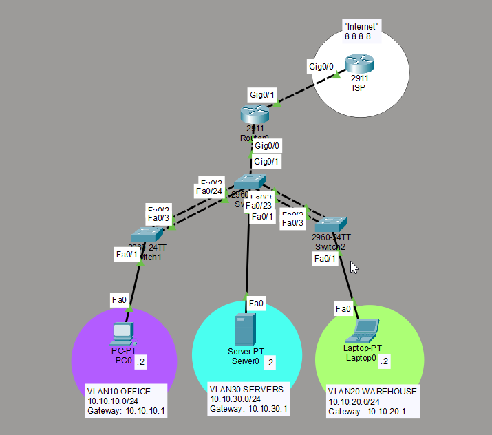

# Cisco Networking Labs

Packet Tracer labs I've built while studying for the CCNA. Each lab includes the topology, configurations, issues, and a short summary of everything.

## Lab 01 — Campus LAN

A small network with one core switch, two access switches, and two routers. The LAN is divided into four VLANs, with a second router acting as a simulated ISP.

### Configuration
- Created VLANs 10, 20, 30, and 99 with 802.1Q trunk links.
- Configured Router-on-a-Stick for inter-VLAN routing.
- Set up LACP EtherChannels between the core and access switches.
- Enabled Rapid PVST+ and made the core switch the root bridge.
- Configured PortFast and BPDU Guard on access ports.
- Added default static routes between the LAN router and simulated ISP.
- Configured a loopback on the ISP router using `8.8.8.8/32`.

### Testing
- Verified communication between VLANs.
- Troubleshot an EtherChannel issue where ports were suspended or not bundling.
- Confirmed both EtherChannels were up with all member ports bundled.
- Tested BPDU Guard by connecting another switch to an access port and confirming it was err-disabled.
- Successfully pinged `8.8.8.8` from a PC on the LAN.

[Packet Tracer File](packet-tracer/01-Campus-LAN-Lab.pkt)

---

More labs to come.

